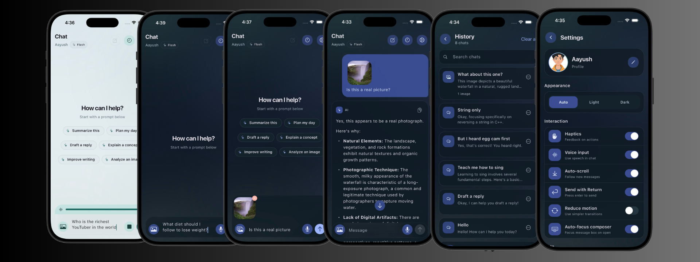

# AI Chatbot

A Flutter chat client for Gemini with streaming answers, image follow-ups, and on-device conversation history.

## App preview



## Run locally

Use Flutter 3.50 for the verified build setup. Android uses Gradle 9.5 and JDK 17 or newer. iOS uses Swift Package Manager for Flutter plugins.

Create `.env` from `.env.example` if needed and set `API_KEY` to your personal Gemini API key. You can also set `GEMINI_MODEL` to override the default `gemini-3.5-flash-lite`. [Get a key in Google AI Studio](https://aistudio.google.com/apikey).

```sh
flutter pub get
flutter run
```

Debug runs read the Gemini settings from `.env` automatically. Restart the run after editing the file. **Settings → Gemini connection** also accepts a key for the current app session.

To use `.env` explicitly in a local profile or release run, pass it to Flutter.

```sh
flutter run --profile --dart-define-from-file=.env
```

Both debug assets and explicit build-time values are accessible to anyone with the resulting app. Use an authenticated server for a shared API key in a public deployment. [API key guidance](https://aistudio.google.com/docs/api-key).

## Chat

- Choose **General**, **Writing**, **Coding**, or **Study** to tailor replies. Starter cards put an editable prompt in the composer.
- Draft text is saved locally for each chat and the new-chat composer when **Save history** is on. Reopen the conversation to resume writing. Session-only draft text and selected files stay in the current composer.
- Open **Find in conversation** to browse prompts or search messages and jump directly to a match. The outline opens alongside the chat on wide screens and in a sheet on smaller screens.
- Bookmark a reply to revisit it from **Saved replies** in the sidebar or History. Selecting a saved reply opens its conversation at that message.
- Watch answers as they stream. Use **Continue reply** to pick up an incomplete answer. Regenerate a reply to try a different answer and open **Reply versions** to inspect earlier versions or restore one for the latest turn. Each reply keeps up to four earlier versions.
- Open **Chat options** to set the reply length and add instructions for that conversation. Saved chats and branches keep these options.
- Attach photos or select **Documents** for PDF, TXT, Markdown, CSV, and JSON files. Each message accepts four attachments, including up to two documents, with a combined limit of 10 MB. Images are limited to 4 MB and PDFs to 6 MB. Text files must use UTF-8 and fit within 20,000 characters. [Gemini document handling](https://aistudio.google.com/docs/document-processing).
- Follow-ups include recent messages and attachments within the request budget. Replies indicate when the request used a reduced context.
- Use the microphone to dictate on platforms with speech recognition. Copy a reply, an individual code block, or an entire conversation as Markdown.
- Search saved conversations by title or message. The sidebar keeps history visible on wider screens. On phones, use **History** to open, rename, or pin a chat.
- Choose **Branch from this reply** or use **Prompt actions → Edit in a branch**. The new conversation keeps the context through the selected turn and its own copies of the attachments. Both conversations are available in history.

**Save history** controls local storage. Turning it off keeps new turns and their attachments in memory for the current conversation. **Clear history** removes saved conversations, bookmarks, and drafts. Gemini receives the prompt and recent context whenever you send a message.

## Checks

```sh
flutter analyze
flutter test
```

Tests use a mocked Gemini transport for streaming, cancellation, retry, and configuration checks. Storage tests use temporary Hive databases to verify legacy chat and profile migration, deletion, and settings persistence.

## License

MIT. See [LICENSE](LICENSE).

Created by Aayush D.C Dangi (dcaayushd).
